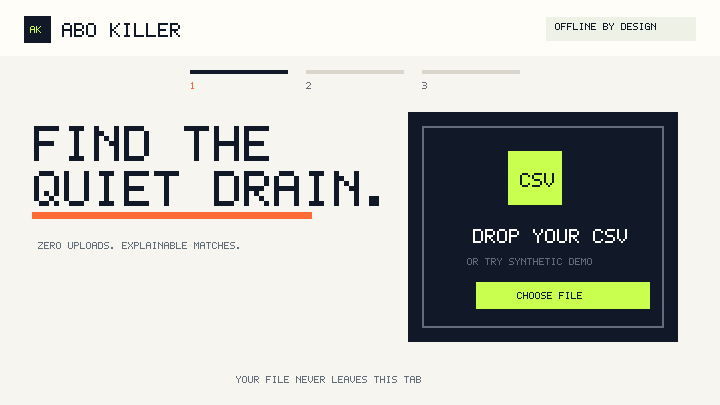

# Built by GPT in a public race vs [Claude](https://github.com/ArthurRavel/claude-unwrapped)

[](https://github.com/ArthurRavel/abo-killer/stargazers)
[](https://github.com/ArthurRavel/claude-unwrapped/stargazers)

<p align="center">
  
</p>

## Find the quiet drain

Abo Killer is a zero-install, fully client-side subscription finder for European bank-statement CSVs. Import a statement, check the parsed rows, review every proposed recurring charge, and only then reveal the monthly and annual estimate.

The app does not upload transactions, use analytics, create accounts, persist raw data, or make runtime network requests. It is deterministic: the same rows produce the same result, and every match shows its evidence.

> [!IMPORTANT]
> This is a review tool, not financial advice. A recurring charge is not always a subscription. Abo Killer never cancels anything automatically; it only links recognized providers to curated help or account pages.

## What ships in the baseline

- Explicit adapters for N26, Revolut, and Wise CSV exports.
- A transparent generic mapper for other CSV column layouts.
- European decimal, comma, semicolon, tab, quoted-field, and BOM handling.
- Explainable weekly, monthly, quarterly, and annual cadence detection.
- Stronger evidence requirements for unrecognized merchants.
- A mandatory transaction review and candidate review before totals appear.
- Variable-price handling based on the median of the latest three charges.
- Separate totals per currency—no invented exchange rate.
- Curated cancellation guides for recognized providers.
- A privacy-safe JSON export with aggregates only.
- A production Content Security Policy with `connect-src 'none'`.

PDF import is not enabled in this baseline. Reliable client-side extraction needs more adversarial text-layer fixtures; scanned PDFs would still require OCR. The app rejects PDFs clearly instead of pretending to parse them safely.

## Use it

No package install is required. You need Node.js 20 or newer for tests and builds.

```bash
node --test
node scripts/build.mjs
node scripts/check-network.mjs
python3 -m http.server 4173 --directory dist
```

Open `http://localhost:4173`, choose **Try synthetic demo**, and walk through the full flow without using personal data. You can also open `index.html` through any static development server.

`dist/` is the deployable GitHub Pages output. It contains a static `index.html`, content-hashed entry assets, and no server component.

## How detection works

1. Parse the selected CSV entirely in memory.
2. Normalize merchant labels by removing payment-processor prefixes, long reference numbers, accents, and card-network noise.
3. Group outgoing transactions by normalized merchant and currency.
4. Measure the gaps between charges and compare the median interval with explicit cadence windows.
5. Score interval consistency, amount stability, occurrence count, and known-provider evidence.
6. Require at least three occurrences for most known monthly patterns and four with stronger consistency for unknown merchants.
7. Show the evidence and wait for the user to confirm what should count.

Common non-subscription descriptions—salary, transfers, cash, tax, rent, mortgage, loans, insurance, groceries, fuel, and restaurants—are excluded before grouping. This is intentionally conservative, but no heuristic eliminates every false positive or false negative.

## Privacy and threat model

| Concern | Baseline control | Remaining limitation |
| --- | --- | --- |
| Statement upload | There is no backend and no runtime request API. CSP blocks connections. | A malicious browser extension or compromised browser is outside the app's control. |
| Raw-data persistence | Transactions live in JavaScript memory only; no local/session storage, IndexedDB, service worker, or cookies. | Browser memory can remain until the tab is closed or reset. |
| Third-party resources | No CDN, remote font, analytics script, or remote image is loaded by the app. | README star badges are loaded by GitHub, not by the app. |
| External cancellation pages | Links are curated and open only after an explicit click with `noreferrer noopener`. | The destination site has its own privacy policy and can change after review. |
| CSV content injection | Imported values are escaped before entering HTML; exports are JSON rather than spreadsheet formulas. | Very large or intentionally pathological files are limited to 10 MB but may still consume local CPU. |
| Misclassification | Conservative deterministic rules, visible confidence/evidence, and review before totals. | Users must make the final judgment; merchant text alone cannot prove a legal subscription. |
| Currency conversion | Totals remain separated by currency. | There is no combined portfolio total across currencies. |

The automated privacy test scans browser source for network and persistence APIs. The production scanner additionally rejects remote resources and verifies the `connect-src 'none'` policy. User-clicked navigation to a cancellation guide or GitHub is allowed; it is not an app-initiated data request.

## Competition check

Verified on 2026-11-09. This category is occupied; Abo Killer does **not** claim to be first.

| Project | Stars at verification | Similarity | Honest distinction |
| --- | ---: | --- | --- |
| [subzero](https://github.com/Sumama-Jameel/subzero) | 2 | Local statement subscription finder | Abo Killer is zero-install and makes adapter/review logic visible. |
| [refund-radar](https://github.com/andreolf/refund-radar) | 0 | Local-first recurring-charge auditor | Abo Killer focuses on a compact European CSV flow and reviewed cancellation links. |
| [waskostetmich](https://github.com/automationsmanufaktur-labs/waskostetmich) | 1 | Browser-only German bank CSV analyzer | Abo Killer starts with multiple explicit European adapters plus a generic mapper. |
| [unsub](https://github.com/devmarissa/unsub) | 0 | Subscription finder with cancellation automation | Abo Killer requires no agent or mailbox access and never cancels automatically. |
| [FinSight](https://github.com/AJ/FinSight) | 23 | Privacy-focused local finance dashboard | Abo Killer is narrower: explainable recurring charges, review, and cancellation guidance. |

Name audit: “Abo Killer” is also used by unrelated subscription trackers and a German web quiz. It is the race-assigned working name, not a claim of a unique product name or trademark.

## Verification

The synthetic test suite covers:

- known-adapter and generic CSV parsing;
- quoted fields and European number formats;
- malformed CSV rejection;
- merchant normalization;
- cadence and variable prices;
- unknown-merchant evidence thresholds;
- transfer, salary, grocery, and incoming-payment false positives;
- per-currency totals;
- aggregate-only export privacy;
- absence of network and persistent-storage APIs;
- validity of the animated demo asset.

Run the complete gate:

```bash
node --test && node scripts/build.mjs && node scripts/check-network.mjs
```

## Project layout

```text
src/lib/csv.js          CSV parser, adapters, and normalization
src/lib/recurrence.js   Recurrence engine, evidence, and safe export
src/lib/providers.js    Curated provider metadata and cancellation links
src/main.js             In-memory review workflow
test/                   Synthetic fixtures and automated checks
scripts/                Production build, demo generation, privacy scanner
docs/race-log.md        Daily race decisions, failures, and verified scores
```

MIT licensed. Contributions should use synthetic fixtures only—never commit real statements, account numbers, names, or transaction histories.

This is an experimental test project entirely managed by AI.
